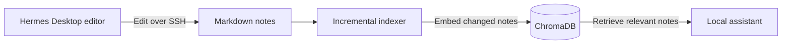

# Jarvis AI Infrastructure

I built Jarvis as a self-hosted AI setup across several Linux machines. It keeps an Obsidian knowledge index up to date and serves retrieval to a local assistant. I separated storage and automation from embedding and inference so the storage host could run on older hardware.

This portfolio repo contains a small, runnable version of incremental retrieval using synthetic notes. It also pins the public Hermes Desktop plugin I use to browse and edit files in remote workspaces over SSH.

## How the pieces fit together



The plugin is the editing interface. Indexing and retrieval are separate services. The demo below covers the path from a Markdown file change to an updated search result, using direct file edits in place of the Desktop UI. It uses a small CPU embedding model and returns the matched note. The assistant and the multi-machine deployment are shown for context.

## Run the retrieval demo

With Docker and Docker Compose installed, run these commands from the repository root.

```sh
docker compose up -d chroma
docker compose run --rm --build demo
docker compose down
```

The demo container downloads about 80 MB of public MiniLM model weights when it starts. ChromaDB runs in a separate container and is reachable from the demo over the Compose network. The Compose file publishes no ports to the host.

The demo indexes three synthetic notes and retrieves a note about greenhouse irrigation. A second sync writes zero vectors. The demo changes the sprinkler material from brass to stainless steel, reindexes only that note, and checks that the same question returns the updated text. It then deletes another note and checks that it disappears from the index.

The [indexer](demo/retrieval.py) stores a SHA-256 hash with each document so it can skip unchanged content. It uses one vector per short note and scans the small demo collection on each run. The demo creates and cleans up a dedicated collection.

## Explore the Hermes plugin

[Hermes SSH Workspaces](https://github.com/HarrjyotSingh/hermes-ssh-workspaces) adds local and SSH-backed file browsing and editing to Hermes Desktop. This repo pins it as an optional Git submodule. Run `git submodule update --init` to inspect the pinned source locally, or follow the link for its separate installation instructions.
