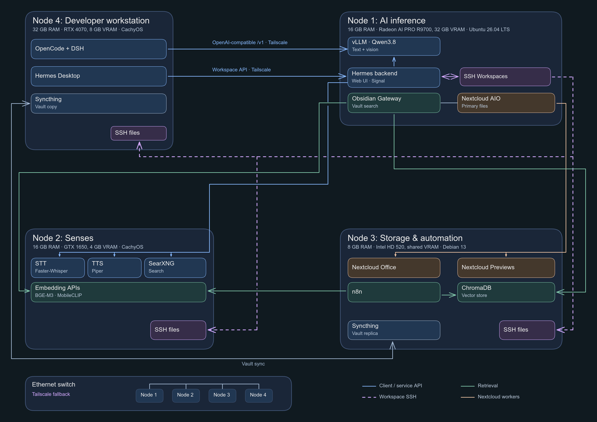

# Jarvis AI Infrastructure

I built Jarvis as a self-hosted AI setup across several Linux machines. It keeps an Obsidian knowledge index up to date and serves retrieval to a local assistant. I separated storage and automation from embedding and inference so the storage host could run on older hardware.

This portfolio repo contains a small, runnable version of incremental retrieval using synthetic notes. It also pins the public Hermes Desktop plugin I use to browse and edit files in remote workspaces over SSH.

## Architecture



[Editable Excalidraw source](docs/jarvis-architecture.excalidraw) · Open in Excalidraw's dark theme.

OpenCode and DSH use the same Qwen3.8 endpoint on the inference server. Hermes Desktop connects to the Hermes backend, where the SSH Workspaces plugin opens files on the other nodes. The wired network carries traffic between the machines, with Tailscale for remote access and configured fallback routes.

## Memory and workload placement

The storage node keeps ChromaDB and n8n available on 8 GB of RAM. A separate machine handles BGE-M3 and MobileCLIP embeddings, and the Radeon GPU server runs Qwen inference. The indexer processes up to 16 text chunks or one visual item per batch. I use the workstation GPU for jobs I can start and stop on demand.

On the live setup, Docker caps n8n at 1.25 GiB, the Nextcloud app at 1 GiB, and the Nextcloud database at 768 MiB. vLLM uses an FP8 KV cache and is configured for up to three concurrent sequences. The storage node uses compressed zram swap.

Before starting an extra job, I check available RAM against the job's upper limit during a busy period. The runbook uses a 4 GiB host reserve for extra workloads and calls for deferring a job if the host is already swapping heavily.

## Run the retrieval demo

The Compose demo runs the retrieval flow locally using synthetic notes. It uses a CPU embedding model to show how one note edit updates the search result.

With Docker and Docker Compose installed, run these commands from the repository root.

```sh
docker compose up -d chroma
docker compose run --rm --build demo
docker compose down
```

The demo container downloads about 80 MB of public MiniLM model weights when it starts. ChromaDB runs in a separate container and is reachable from the demo over the Compose network. The Compose file publishes no ports to the host.

The demo indexes three synthetic notes and retrieves a note about greenhouse irrigation. A second sync writes zero vectors. The demo changes the sprinkler material from brass to stainless steel, reindexes only that note, and checks that the same question returns the updated text. It then deletes another note and checks that it disappears from the index.

The [indexer](demo/retrieval.py) stores a SHA-256 hash with each document so it can skip unchanged content. It uses one vector per short note and scans the small demo collection on each run. The demo creates and cleans up a dedicated collection.

## Explore the Hermes plugin

[Hermes SSH Workspaces](https://github.com/HarrjyotSingh/hermes-ssh-workspaces) adds local and SSH-backed file browsing and editing to Hermes Desktop. This repo pins it as an optional Git submodule. Run `git submodule update --init` to inspect the pinned source locally, or follow the link for its separate installation instructions.
